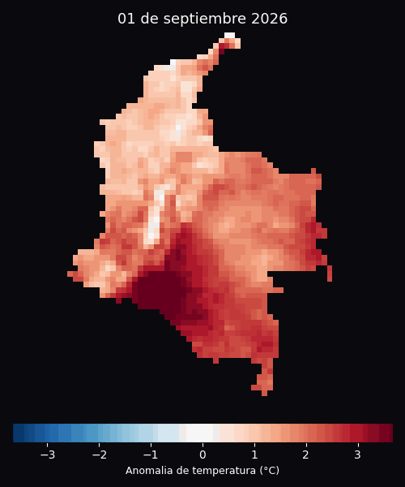

<p align="center">
  <strong style="font-size:28px;">forge3d-colombia</strong>
</p>

<p align="center">
  <strong>Terreno y cartografia path-traced para Colombia.</strong><br>
  Fork completo de <a href="https://github.com/milos-agathon/forge3d">forge3d</a> (Rust + WebGPU) sin modificar el motor, con datos y ejemplos propios.
</p>

<p align="center">
  <a href="https://pypi.org/project/forge3d/"></a>
  <a href="https://github.com/milos-agathon/forge3d/blob/main/LICENSE"></a>
  <a href="https://github.com/milos-agathon/forge3d"></a>
</p>

<p align="center">
  
</p>

<p align="center">
  <sub><b>Serrania de la Macuira</b>, La Guajira — bosque nuboso aislado sobre el desierto costero, cerca de Punta Gallinas.<br>
  DEM Copernicus GLO-30 &nbsp;·&nbsp; render via <code>examples/la_guajira.py</code></sub>
</p>

---

Este proyecto **no modifica el motor de render**: incluye el codigo fuente
completo de `forge3d` (Rust + bindings Python, compilado localmente con
maturin) y aporta datos geograficos de Colombia, un registro de datasets y
ejemplos ejecutables, con documentacion en espanol.

## Instalacion

Compilar desde el codigo fuente (lo que usa este repo) requiere Rust
([rustup](https://rustup.rs/)) y, en Windows, el componente C++ de Visual
Studio Build Tools:

```bash
pip install maturin
pip install -e . --no-build-isolation
pip install -r requirements.txt
```

También se puede usar el paquete publicado en PyPI en vez de compilar:

```bash
pip install forge3d
pip install -r requirements.txt
```

## Sesenta segundos a un render

```python
import forge3d as f3d
from forge3d_colombia.datasets import fetch_dem

dem_path = fetch_dem("la-guajira")

with f3d.open_viewer_async(terrain_path=dem_path, width=1440, height=900) as viewer:
    viewer.set_z_scale(2.0)
    viewer.set_orbit_camera(phi_deg=35, theta_deg=55, radius=18000, fov_deg=42)
    viewer.set_sun(azimuth_deg=280, elevation_deg=18)
    viewer.snapshot("la_guajira.png", width=1920, height=1080)
```

Tambien disponible como script: [`examples/la_guajira.py`](examples/la_guajira.py).
Requiere una GPU compatible con WebGPU.

```python
from forge3d_colombia.datasets import fetch_dem, list_datasets

print(list_datasets())
```

| Dataset      | Descripcion                                                                 | Fuente                              |
|--------------|------------------------------------------------------------------------------|--------------------------------------|
| `la-guajira` | Desierto de La Guajira, Serrania de la Macuira y costa Caribe cerca de Punta Gallinas (punto mas septentrional de Sudamerica) | Copernicus GLO-30 DEM (~30 m), ESA/Copernicus Programme |

---

## Hecho con forge3d-colombia

### Anomalia de temperatura diaria — septiembre 2026

Inspirado en ["A warmer shape of summer, day by day"](https://lnkd.in/p/ej6MgpQD)
de Milos Popovic sobre Europa — ese post usa forge3d por debajo (su enlace a
"la herramienta" apunta al propio repositorio). Un relieve 3D por cada dia
del mes: la temperatura media diaria a 2 m frente a la normal climatologica
1991-2020, con datos ERA5-Land (~9 km) reales.

La altura y el color muestran la misma anomalia con signo — calido sube,
frio se hunde, no es elevacion real del terreno. El relieve es la propia
rejilla de ERA5-Land sin suavizar (~9 km, celda a celda), cargada como
terreno en el visor interactivo de forge3d y controlada por IPC — el mismo
mecanismo que usan los ejemplos de
[`population_spike_worldpop`](examples/population_spike_worldpop). El color
es un overlay PNG con un colormap continuo muestreado pixel a pixel de la
paleta del video original, cargado con `preserve_colors=True` para que el
motor lo componga *despues* de la iluminacion 3D en vez de teñirlo con el
tonemap (lo que pasa con un `RasterOverlay` normal de `MapScene` — ver
[`docs/guides/thematic_raster_styles.md`](docs/guides/thematic_raster_styles.md)).
PBR con sombras `pcss` y ambient occlusion basado en altura (entre "agujas"
vecinas) es lo que le da la textura y profundidad marcadas. El panel
editorial (titulo, fecha, media diaria, mini histograma, leyenda, firma) se
compone con Pillow sobre el snapshot, con una sombra proyectada sintetica.

<p align="center">
  
</p>

<p align="center">
  
</p>
<p align="center">
  <sub>Version con transicion suave dia a dia (mejor calidad, ~13 s, descarga para reproducir):
  <a href="docs/assets/colombia_temp_anomaly_202609.mp4">colombia_temp_anomaly_202609.mp4</a></sub>
</p>

### Reproducir o generar otro mes

Requiere una GPU compatible con WebGPU (el relieve se renderiza con el
visor interactivo de forge3d, igual que el resto de ejemplos).

```bash
pip install cdsapi xarray netCDF4 rasterio geopandas matplotlib imageio imageio-ffmpeg

# 1. Cuenta gratuita + API key en https://cds.climate.copernicus.eu/
#    y aceptar la licencia de "ERA5-Land hourly data" y
#    "ERA5-Land monthly averaged data". Guardar la key en ~/.cdsapirc
#    (ver cabecera del script).

python scripts/fetch_era5_colombia.py              # mes anterior completo
python scripts/fetch_era5_colombia.py 2026 08       # o un mes/anio especifico
python scripts/render_temperature_anomaly.py 2026 08
```

`fetch_era5_colombia.py` descarga la media diaria de t2m de ERA5-Land
(producto derivado "daily statistics", calculado del lado del servidor) y
la climatologia mensual 1991-2020, calcula la anomalia diaria y la guarda
como GeoTIFF multibanda en `assets/era5/`. `render_temperature_anomaly.py`
recorta por el contorno de Colombia
([`assets/geojson/colombia_boundary.geojson`](assets/geojson/colombia_boundary.geojson)),
renderiza el relieve de cada dia con `forge3d.MapScene` y compone el
mosaico, el GIF y el video en `docs/assets/`.

> Si `rasterio` falla con un error de `PROJ`/`EPSG` al escribir el GeoTIFF
> (tipico cuando hay otra instalacion de PROJ en el sistema, p. ej. PostGIS),
> fija `PROJ_LIB` a la carpeta `proj_data` incluida en tu propio `rasterio`
> antes de ejecutar los scripts.

---

## Agregar mas lugares de Colombia

El registro vive en [`forge3d_colombia/datasets.py`](forge3d_colombia/datasets.py).
Para agregar una nueva zona (p. ej. Nevado del Ruiz, Sierra Nevada de Santa
Marta, Cocuy):

1. Descargar el tile DEM correspondiente (Copernicus GLO-30 es de acceso
   publico sin API key: `https://copernicus-dem-30m.s3.amazonaws.com/`).
2. Guardarlo en `assets/tif/`.
3. Agregar una entrada al diccionario `_DATASETS` con nombre, archivo,
   descripcion y fuente.

## Atribucion y licencia

- Motor de render: [forge3d](https://github.com/milos-agathon/forge3d), (c) 2025-2026
  Milos Popovic, licenciado Apache-2.0 / MIT. Este fork incluye el codigo
  fuente completo del motor (compilado localmente con Rust + maturin) sin
  modificarlo; solo se agregan datasets y scripts propios encima.
- Datos de elevacion: Copernicus DEM GLO-30, producido con financiamiento de
  la Comision Europea en el marco del Programa Copernicus, provisto por el
  Agencia Espacial Europea (ESA) de acceso abierto y gratuito.
- Datos de temperatura: ERA5-Land (Munoz-Sabater et al., 2021), generados
  con el Copernicus Climate Change Service (C3S) del ECMWF. Ni la Comision
  Europea ni el ECMWF son responsables de ningun uso que se le de a esta
  informacion.
- Idea y diseño original del mapa de anomalia diaria:
  [Milos Popovic, "A warmer shape of summer, day by day"](https://lnkd.in/p/ej6MgpQD).
- Codigo propio de este fork (`forge3d_colombia/`, `examples/`, `scripts/`): MIT, ver
  [`LICENSE`](LICENSE).
