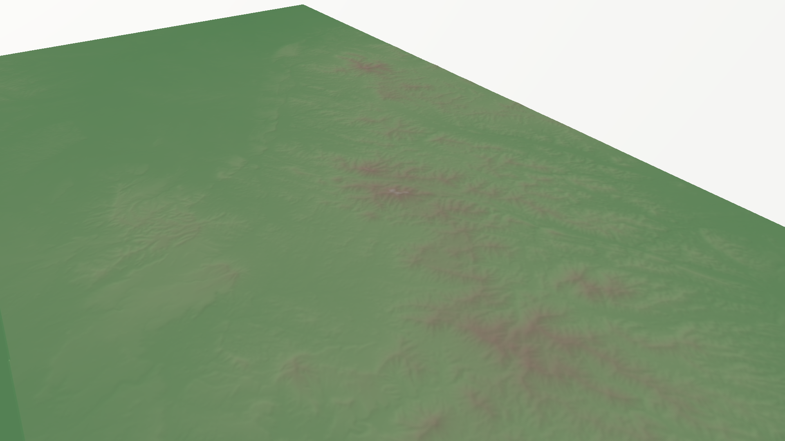
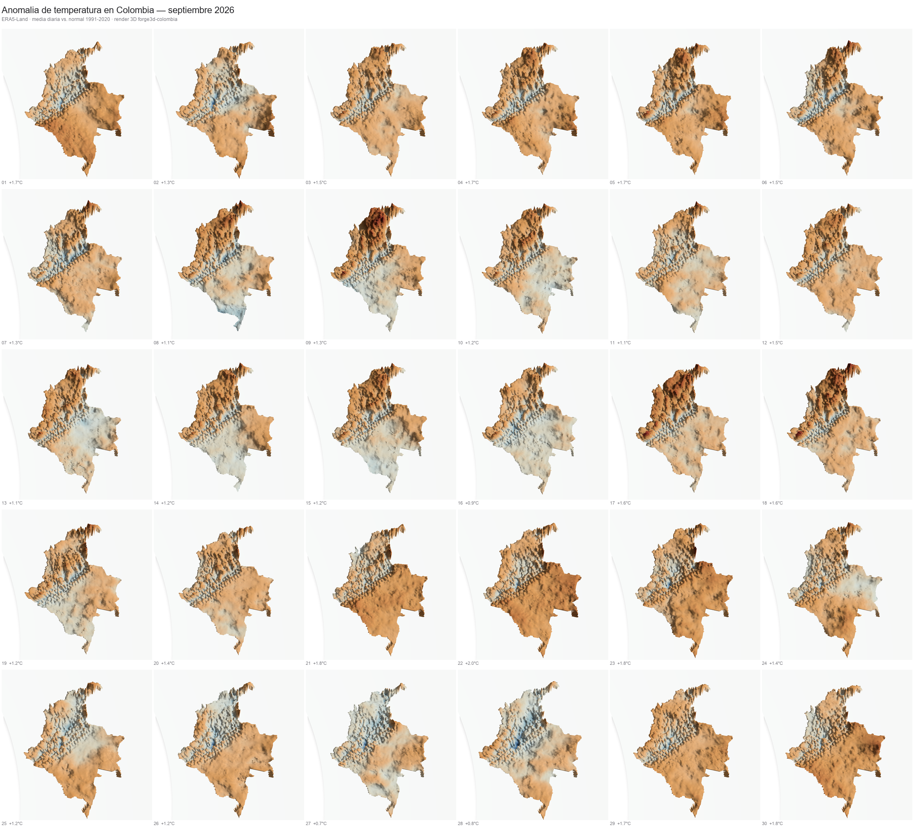

# forge3d-colombia

Fork ligero de [forge3d](https://github.com/milos-agathon/forge3d) (terreno y
cartografia path-traced para Python, motor en Rust + WebGPU) con un registro
de datasets y ejemplos propios centrados en **Colombia**.

Este proyecto no reimplementa el motor de render: usa el paquete `forge3d`
tal cual se publica en PyPI y solo aporta datos de elevacion de Colombia,
scripts de ejemplo y documentacion en espanol.

<p align="center">
  
</p>
<p align="center">
  <sub>Serrania de la Macuira, La Guajira — render generado por
  <code>examples/la_guajira.py</code> sobre un DEM Copernicus GLO-30.</sub>
</p>

## Instalacion

```bash
pip install forge3d
pip install -r requirements.txt
```

## Datasets incluidos

| Dataset      | Descripcion                                                                 | Fuente                              |
|--------------|------------------------------------------------------------------------------|--------------------------------------|
| `la-guajira` | Desierto de La Guajira, Serrania de la Macuira y costa Caribe cerca de Punta Gallinas (punto mas septentrional de Sudamerica) | Copernicus GLO-30 DEM (~30 m), ESA/Copernicus Programme |

```python
from forge3d_colombia.datasets import fetch_dem, list_datasets

print(list_datasets())
dem_path = fetch_dem("la-guajira")
```

## Sesenta segundos a un render

```python
import forge3d as f3d
from forge3d_colombia.datasets import fetch_dem

dem_path = fetch_dem("la-guajira")

with f3d.open_viewer_async(terrain_path=dem_path, width=1440, height=900) as viewer:
    viewer.set_z_scale(2.0)
    viewer.set_orbit_camera(phi_deg=35, theta_deg=55, radius=18000, fov_deg=42)
    viewer.set_sun(azimuth_deg=280, elevation_deg=18)
    viewer.snapshot("la_guajira.png", width=1920, height=1080)
```

Tambien disponible como script: [`examples/la_guajira.py`](examples/la_guajira.py).
Requiere una GPU compatible con WebGPU.

## Anomalia de temperatura diaria (al estilo "August was hot in Europe")

Replica del [post de Milos Popovic](https://lnkd.in/p/ej6MgpQD) sobre Europa,
aplicada a Colombia: un mapa por cada dia del mes con la diferencia de
temperatura a 2 m frente al promedio climatologico 1991-2020, usando datos
ERA5 (Copernicus Climate Data Store).

<p align="center">
  
</p>
<p align="center">
  <video src="https://raw.githubusercontent.com/guairo/forge3d-colombia/main/docs/assets/colombia_temp_anomaly_202609.mp4" width="320" controls loop muted>
    Tu visor de Markdown no reproduce video embebido; abre
    <a href="docs/assets/colombia_temp_anomaly_202609.mp4">colombia_temp_anomaly_202609.mp4</a> directamente,
    o usa el GIF: <a href="docs/assets/colombia_temp_anomaly_202609.gif">colombia_temp_anomaly_202609.gif</a>.
  </video>
</p>

```bash
pip install cdsapi xarray netCDF4 rasterio geopandas matplotlib imageio imageio-ffmpeg

# 1. Cuenta gratuita + API key en https://cds.climate.copernicus.eu/
#    y aceptar la licencia de "ERA5 hourly/monthly single levels".
#    Guardar la key en ~/.cdsapirc (ver cabecera del script).

python scripts/fetch_era5_colombia.py              # mes anterior completo
python scripts/fetch_era5_colombia.py 2026 08       # o un mes/anio especifico
python scripts/render_temperature_anomaly.py 2026 08
```

`fetch_era5_colombia.py` descarga t2m horario del mes objetivo y la
climatologia mensual 1991-2020, calcula la anomalia diaria y la guarda como
GeoTIFF multibanda en `assets/era5/`. `render_temperature_anomaly.py` recorta
por el contorno de Colombia ([`assets/geojson/colombia_boundary.geojson`](assets/geojson/colombia_boundary.geojson))
y genera el mosaico y el GIF en `docs/assets/`.

> Si `rasterio` falla con un error de `PROJ`/`EPSG` al escribir el GeoTIFF
> (tipico cuando hay otra instalacion de PROJ en el sistema, p. ej. PostGIS),
> fija `PROJ_LIB` a la carpeta `proj_data` incluida en tu propio `rasterio`
> antes de ejecutar los scripts.

## Agregar mas lugares de Colombia

El registro vive en [`forge3d_colombia/datasets.py`](forge3d_colombia/datasets.py).
Para agregar una nueva zona (p. ej. Nevado del Ruiz, Sierra Nevada de Santa
Marta, Cocuy):

1. Descargar el tile DEM correspondiente (Copernicus GLO-30 es de acceso
   publico sin API key: `https://copernicus-dem-30m.s3.amazonaws.com/`).
2. Guardarlo en `assets/tif/`.
3. Agregar una entrada al diccionario `_DATASETS` con nombre, archivo,
   descripcion y fuente.

## Atribucion y licencia

- Motor de render: [forge3d](https://github.com/milos-agathon/forge3d), (c) 2025-2026
  Milos Popovic, licenciado Apache-2.0 / MIT. Este fork no modifica ese codigo,
  solo depende de el via PyPI.
- Datos de elevacion: Copernicus DEM GLO-30, producido con financiamiento de
  la Comision Europea en el marco del Programa Copernicus, provisto por el
  Agencia Espacial Europea (ESA) de acceso abierto y gratuito.
- Datos de temperatura: ERA5 (Hersbach et al., 2020), generados con el
  Copernicus Climate Change Service (C3S) del ECMWF. Ni la Comision Europea
  ni el ECMWF son responsables de ningun uso que se le de a esta informacion.
- Idea original del mapa de anomalia diaria: [Milos Popovic](https://lnkd.in/p/ej6MgpQD).
- Codigo propio de este fork (`forge3d_colombia/`, `examples/`, `scripts/`): MIT, ver
  [`LICENSE`](LICENSE).
